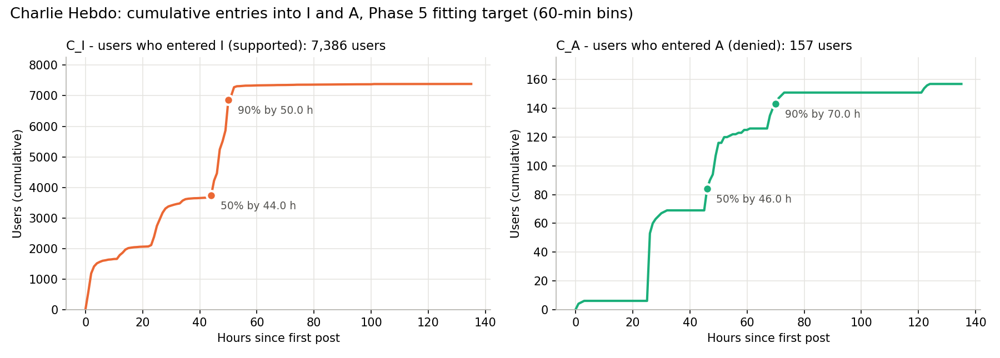
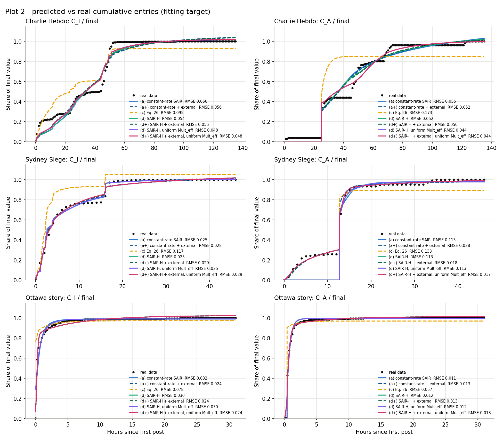
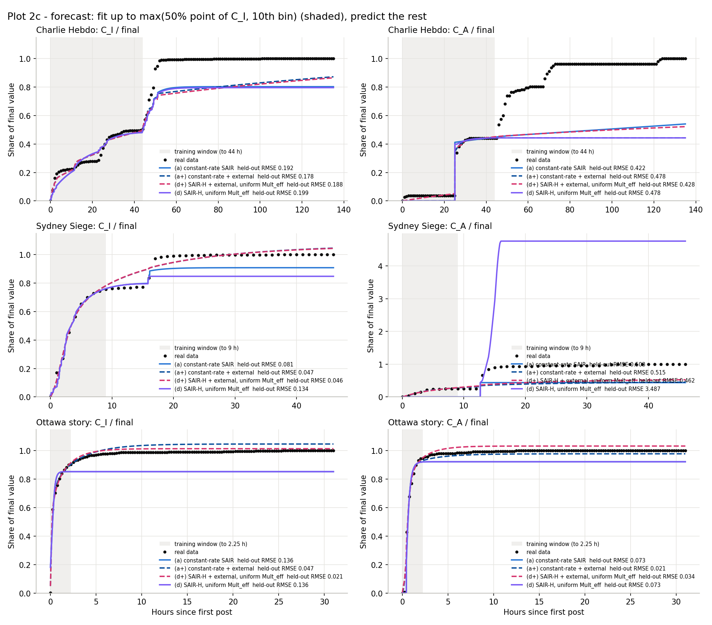
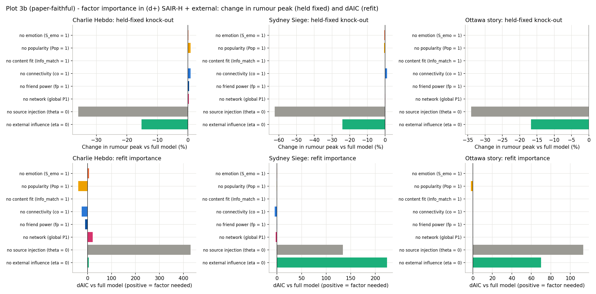
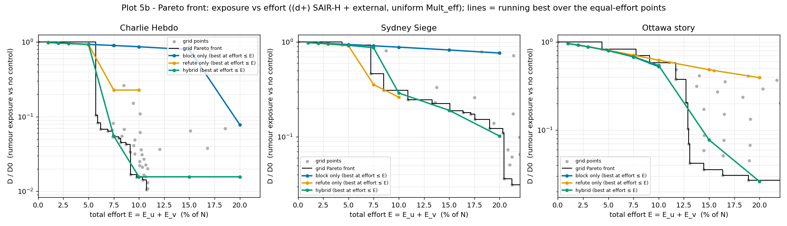
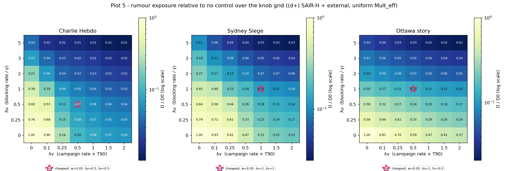
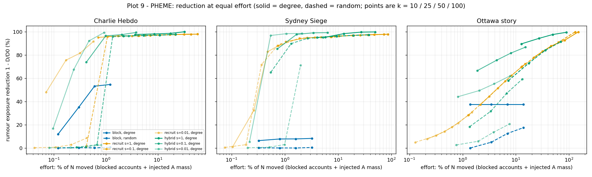
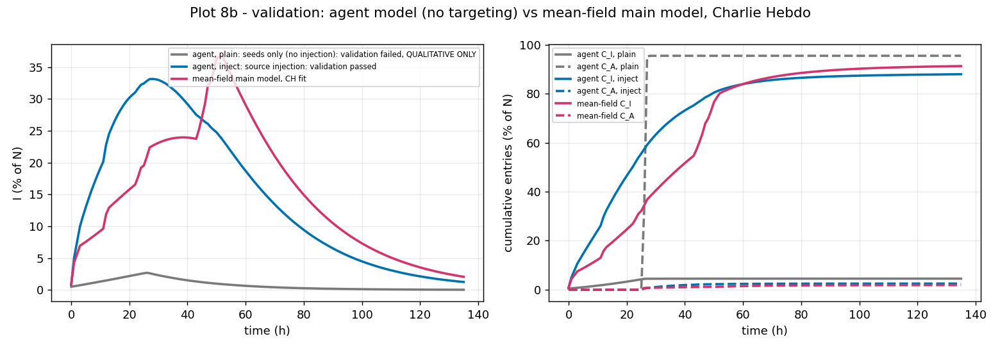
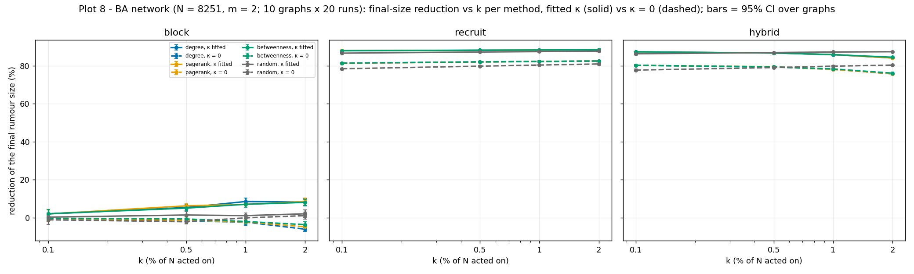

# Whom to Silence, Whom to Amplify: Centrality-Targeted Hybrid Control of Rumour–Correction Competition on Social Networks

**Project report.** All numbers in this report are taken from the CSV files in `results/`; the tables are generated from them by
`src/report_check.py`, which also verifies every number quoted in the text (Section 9). Design decisions are numbered D1–D83 and
logged in `DECISIONS.md`.

---

## Abstract

Rumours and their corrections spread together and compete for the same audience. The SAIR model of Li et al. (2026)
models this competition with susceptible, rumour, correction and removed compartments whose rates are driven by per-user
"push" factors and a friends'-majority game. We re-implemented SAIR on the PHEME rumour dataset (two crisis events and one story; false and unverified rumours
only), under strict leakage controls, and fitted it to the cumulative entry curves of rumour supporters and deniers. We
found a structural flaw: in the paper's (corrected) Eq. 26 the rumour and the correction can never grow at the same time, and the
model is the worst of nine candidates on every set. Our replacement, SAIR-H+ (SAIR rates scaled by the friends'-majority drive, plus
Bass external influence and source injection), is the best model family overall (total AIC -4295.2); the paper's per-user factors are
not supported by the data. We extend it to SAIR-C, with blocking and correction-campaign knobs. At equal effort, the three strategies
tie at low effort; a hybrid strategy tips Charlie Hebdo into a correction-dominated state at 10% effort (hybrid D/D0 = 0.016 at 10% effort on Charlie Hebdo), but this
depends on how users without sided friends are modelled. Centrality-targeted blocking works because the network hubs are the
rumour's source accounts; targeted recruiting of correctors works through an interaction of a small correction mass with the
followers' friends'-majority. A calibrated agent-based model on Barabási–Albert graphs confirms that hubs beat random targeting by a
wide margin.

---

## 1 Introduction

False or unverified claims spread fast during crises, and so do the corrections that follow them. Platforms have two broad levers:
**silencing** rumour spreaders (blocking accounts or removing posts) and **amplifying** corrections (fact-check campaigns,
recruiting credible accounts). Which lever works better, how much of each, and *whom* to target are open questions that a
quantitative model of rumour–correction competition can help answer.

The starting point is the SAIR model (Li et al., 2026), which extends the SIR epidemic model with an anti-rumour state A and
drives the infection rates by per-user push factors computed from text, profiles and the follower network. The paper reports good
fits to Twitter data and ablation figures in which every push factor matters.

This project asks three questions: (i) does SAIR, implemented faithfully and without information leakage, fit real rumour data,
and do its factors matter; (ii) once we have a model that fits, how should blocking and correction campaigns be combined; (iii)
whom should they target?

**Contributions.**

1. A leakage-controlled re-implementation of SAIR on PHEME, with six documented corrections to the paper (C1–C6), including a sign
   swap in Eq. 26 and an undefined variable.
2. A structural result: in Eq. 26 (corrected) the rumour and the correction can never grow at the same time (proof in Section 4.2),
   which explains why the paper's model cannot fit the early co-growth seen in every data set.
3. SAIR-H+, a model that keeps SAIR's friends'-majority mechanism, adds Bass (1969) external influence and source injection, and wins a
   nine-model contest by total AIC, with forecast, parameter-recovery and bootstrap validation.
4. An ablation showing which mechanisms the data support (source injection, external influence, the network majority on Charlie
   Hebdo) and which they do not (the paper's per-user factors), compared claim by claim with the paper.
5. SAIR-C: blocking and correction-campaign control with event-relative knobs, an equal-effort comparison, a Pareto front and a
   robustness analysis of a tipping result.
6. Centrality-targeted intervention on the real follow graph, decomposed into channels, with an effort-fair comparison, plus a
   calibrated agent-based test on synthetic scale-free networks.

---

## 2 Related work

**Rumour models.** Rumour spreading has been modelled with epidemic-style compartments since Daley and Kendall (1964) [not verified
online]. SAIR (Li et al., 2026) adds a competing correction state, emotion- and popularity-based push factors, a layered ("higher-order")
network with core, strong and weak layers, and a game in which users side with their friends' majority. We use it as the base paper.

**Rumour control.** Budak, Agrawal and El Abbadi (2011) study limiting misinformation by seeding a competing "good" campaign, and
show that choosing whom to seed is a hard combinatorial problem; influence-maximisation work (Kempe, Kleinberg and Tardos, 2003)
provides the greedy seeding framework. Zhong et al. (2026) combine double refutation (people and media spreading the truth) with
double blocking in a stochastic rumour model and derive optimal controls; we borrow their idea of combining refutation with
blocking, the blocked state B and the quadratic cost form, but not their stochastic optimal-control machinery.

**External influence.** Bass (1969) separates adoption into innovation (external influence, proportional to the susceptible pool)
and imitation (contact, proportional to adopters × susceptibles). We use this split to let rumours and corrections enter from
outside the observed population.

**Targeting in scale-free networks.** Albert, Jeong and Barabási (2000) show that scale-free networks tolerate random failures but are
fragile to attacks on hubs; Pastor-Satorras and Vespignani (2002) show that random immunisation fails on scale-free networks while
targeting the most connected nodes works; Cohen, Havlin and ben-Avraham (2003) propose acquaintance immunisation, which reaches hubs
without global knowledge. The Barabási–Albert model (Barabási and Albert, 1999) generates the synthetic networks of Section 4.8.

**Data.** PHEME (Zubiaga et al., 2016) provides Twitter conversation threads around breaking news with human stance labels;
RumourEval 2019 (Gorrell et al., 2019) reuses part of it, and we used it only to cross-check labels.

---

## 3 Data

**Source.** The PHEME rumour scheme dataset (journalism use case; figshare 2068650, CC BY 4.0) is the only public dataset we found
with human stance labels, who-follows-whom edges and retweets in the same threads (D1).

**Veracity filter.** We keep only FALSE and UNVERIFIED stories. Supporters of true news are not rumour spreaders, so TRUE stories
are excluded (D20).

**States.** A user's state is fixed by their first support or deny post toward the rumour (reply stance is composed with the source
tweet's stance; retweets inherit the source stance): supporters enter I, deniers enter A, users who only query or comment stay
susceptible (D3–D6). Users never switch sides.

**Events.** An event is usable if it has at least 100 deniers and at least 15 informative hourly bins for both curves (D21).
Charlie Hebdo is the primary event (N = 8251 posting users: 7389 I users and 157 A users) and Sydney Siege (N = 3105) the
secondary one. The robustness set is the Ottawa story "There were three separate shooting incidents", the only case with a large
number of both supporters and deniers of one story (441 supporters and 266 deniers), at 15-minute bins (D23). Germanwings has too few
deniers and the Ottawa event as a whole has too few informative bins.

**Fitting target.** We fit the cumulative entry curves C_I(t) and C_A(t) (users whose first support / deny post is by t), trimmed at
the time both reach 99% of their final value plus 12 h (D14, D22). They correspond to the model's cumulative inflows.

**Population and graph.** N contains only users who posted; non-posting followers are not observed, so curve shapes and timing are
compared, not absolute peak heights (D15). The directed graph combines follow edges (u follows v) and reply/retweet interaction
edges. The follow edges are available only among the participants of each thread (D38), which is a limitation of every network
quantity.

**Table 1.** Data sets after the veracity filter (`phase1_summary.csv`).

<!-- table:data -->
| Set | N (posters) | I users | A users | neutral (S) | threads | bin (min) | window (h) | informative bins C_I | informative bins C_A | follow edges | interaction edges |
|---|---|---|---|---|---|---|---|---|---|---|---|
| Charlie Hebdo | 8251 | 7389 | 157 | 705 | 35 | 60 | 135 | 51 | 47 | 10619 | 4756 |
| Sydney Siege | 3105 | 2834 | 148 | 123 | 20 | 60 | 46 | 16 | 21 | 3593 | 1927 |
| Ottawa story | 721 | 441 | 266 | 14 | 2 | 15 | 31 | 14 | 8 | n/a | n/a |
<!-- /table:data -->

*Figure 1. Cumulative entry curves C_I(t) and C_A(t) of Charlie Hebdo, the fitting target (`cumulative_curves_charliehebdo.png`).*

---

## 4 Methods

### 4.1 SAIR and the corrections to the paper

SAIR has four states: S (not yet sided), I (rumour spreader), A (correction spreader) and R (stopped). A user's push toward the
rumour is Drif1 = sigmoid((2·P1 − 1)·Mult_eff), where P1 is the share of the user's sided friends who support the rumour and
Mult_eff is a regression-based multiplier built from emotion, popularity, content fit, layer-based influence and group attraction;
Drif2 = 1 − Drif1. The population-level drives are δ1 = mean Drif1 over not-yet-sided users and δ2 = 1 − δ1. The paper's Eq. 26 is

dS = −δ1·I·S − δ2·A·S, dI = δ1·I·S − (1 − δ1)·I, dA = δ2·A·S − (1 − δ2)·A, dR = (1 − δ1)·I + (1 − δ2)·A.

We corrected six problems (DECISIONS, table "Corrections"):

| # | Issue in the paper | Our fix |
|---|---|---|
| C1 | Eq. 26 attaches δ1 (the rumour push) to A and δ2 to I | δ1 drives I, δ2 drives A |
| C2 | Eq. 24's binomial looks like a new quantity | its mean equals Drif, so δ = mean Drif over susceptible users |
| C3 | "Initiative" in Algorithm 1 is never defined | dropped |
| C4 | the regression target for Mult_eff is not specified | target = the user's first side is I (sided users only, D39) |
| C5 | Eq. 7 adds a 0–1 similarity to a raw mutual-friend count | Jaccard of friend lists |
| C6 | γ is used for the group weight and for a removal rate | the group weight is renamed w_part |

### 4.2 Structural result: Eq. 26 cannot produce co-growth (D49)

**Proposition.** In Eq. 26 (corrected) with δ2 = 1 − δ1 and S ∈ [0, 1], I and A cannot both grow at the same time.

**Proof.** dI/dt = I·(δ1·S − (1 − δ1)) > 0 if and only if δ1·(1 + S) > 1, i.e. δ1 > 1/(1 + S).
dA/dt = A·((1 − δ1)·S − δ1) > 0 if and only if (1 − δ1)·S > δ1, i.e. δ1 < S/(1 + S).
For S ∈ [0, 1], S/(1 + S) ≤ 1/2 ≤ 1/(1 + S), with equality only at S = 1. Both conditions would require
1/(1 + S) < δ1 < S/(1 + S), an empty interval. Hence at most one of I and A grows at any time. ∎

The data show I and A entries rising together in the first hours of every set (D49), and the paper's own discussion of its Fig. 9
describes such a "cooperative" phase, which Eq. 26 cannot produce. Section 5.1 shows the consequence: Eq. 26 fits worst of all models.

### 4.3 SAIR-H and SAIR-H+

We keep the SAIR rates of the paper's Eq. 22 and scale them by the drives (D50):

dS = −β·δ1·I·S − α·δ2·A·S − (η_I + η_A)·S, dI = β·δ1·I·S + η_I·S − γ·I, dA = α·δ2·A·S + η_A·S − ε·A, dR = γ·I + ε·A.

Here I grows iff β·δ1·S > γ and A grows iff α·δ2·S > ε, which are independent conditions. The terms η_I·S and η_A·S are Bass external
influence (D57): users can meet a rumour or a correction outside the observed population. **Source injection** (D46): at the time of
each supporting (denying) source tweet, θ·w_s/Σw of the population moves from S to I (A), with w_s = log(1 + followers of the source
author), known at posting time. **Data-driven drive** (D45): P1 for each user uses the friends who have entered I or A in the data by
time t, re-weighted by the model's own cumulative curves (ρ = C_model / C_data), so interventions feed back into δ; users with no sided
friends get the model's global share I/(I + A).

Variants: (a) constant rates (Eq. 22); (a+) with Bass; (b), (c) Eq. 26 with uniform or ranked Mult_eff; (d) SAIR-H; (d+) SAIR-H + Bass;
(d)-uniform and (d+)-uniform, where every user has Mult_eff = κ (the per-user regression factors drop out); (e) mean-field, where every
user's P1 is the global share. The main model is **(d+)-uniform**, chosen by the best total AIC over the three sets (D69).

### 4.4 Fitting protocol

Least squares on C_I/C_I,final and C_A/C_A,final at the data bins; AIC = n·ln(SSE/n) + 2k. Bounded Nelder–Mead (Nelder and Mead, 1965) in
log space for the rates; rates in [1e-3, 50] per hour, κ in [0, 50], θ and η in [0, 1]; 20 random starts (seed 42), 25 for the main
candidates, plus cross-model starts so that no model ends up worse than its own submodel (D64). Euler steps of bin/50, halved until
rate·dt ≤ 0.025, run in a numba kernel that is bitwise identical to the Python loop (D62). Validation: a forecast fitted up to the
later of the C_I 50% point and the 10th bin; parameter recovery from noisy synthetic curves (σ = 0.01); a moving-block bootstrap
(Künsch, 1989) with blocks of 5 bins (D59, D60). Cumulative residuals are autocorrelated, so small AIC differences (below about 10)
are read as ties.

### 4.5 Leakage controls

User features use only the user's own posts written before they took a side, plus the profile description; retweeted text is never
used (D27). Friend power counts only timestamped replies and retweets received before the user's entry, excluding the user's own (D29).
PageRank uses follow edges only (interaction edges are created by the spreading itself, D32). Groups are k-means clusters of profile
features, not clusters of shared retweets (D37). Every single feature must have an AUC of at most 0.95 for the side taken (Table 2).

**Table 2.** Single-feature AUC for the side taken (I vs A), in either direction (`phase2_auc.csv`). All are far below the 0.95 tripwire.

<!-- table:leak -->
| Feature (single-feature AUC, either direction) | Charlie Hebdo | Sydney Siege | Ottawa story |
|---|---|---|---|
| S_emo | 0.539 | 0.502 | 0.518 |
| Info_match | 0.507 | 0.521 | 0.502 |
| connectivity | 0.520 | 0.513 | 0.604 |
| friend_power | 0.641 | 0.533 | 0.763 |
| has_text | 0.501 | 0.504 | 0.505 |
| has_emotion | 0.541 | 0.542 | 0.521 |
| has_friends | 0.536 | 0.515 | 0.526 |
<!-- /table:leak -->

**Table 3.** The Phase 4 regression barely predicts the side, and P1's separation is thread identity: within threads that contain both
sides, the friends' majority is at chance (`phase4_cv.csv`, `phase4_p1_within_thread.csv`).

<!-- table:p1 -->
| Set | regression CV AUC (stratified) | regression CV AUC (thread held out) | P1 AUC overall | P1 AUC within threads | threads with both sides |
|---|---|---|---|---|---|
| Charlie Hebdo | 0.512 | 0.314 | 0.859 | 0.428 | 12 |
| Sydney Siege | 0.583 | 0.532 | 0.864 | 0.491 | 14 |
| Ottawa story | 0.559 | 0.086 | 0.978 | 0.427 | 2 |
<!-- /table:p1 -->

### 4.6 SAIR-C: blocking and correction campaigns

SAIR-C adds a blocked state B and two constant knobs, applied from t = 0 (D73): blocking moves I to B at rate u, and a correction
campaign moves S to A at rate v (campaign recruits count as A entries). Blocked users stop posting, so P1 uses ρ_I = (C_I − B)/C_I,data.
The fitted rates differ by two orders of magnitude between sets, so the knobs are event-relative: u = λu·γ with λu ∈ {0, 0.25, …, 5},
and v = λv/T90 with λv ∈ {0, 0.1, …, 2}, where T90 is the time the data's C_I reaches 90%. Outcomes are the rumour exposure D = ∫I dt
relative to no control (D/D0), and the efforts E_u = ∫u·I dt and E_v = ∫v·S dt (fractions of N). Strategies (block only, refute only,
hybrid) are compared at **equal total effort** E_u + E_v by solving E = budget along rays in knob space and taking the best root (D74).
The feedback test reruns the grid with ρ frozen at 1, and with δ1(t) frozen to its no-control path.

### 4.7 Centrality-targeted intervention on PHEME

k accounts (k ∈ {10, 25, 50, 100}) are chosen by in-degree, PageRank or betweenness (k = 500 sampling) on the follow graph, or at random
(15 draws, with the 95% CI of the mean) (D77). **Block** acts on accounts that enter I in the data, through two channels: (i) they no longer
count as rumour friends of their followers, and (ii) a supporting source tweet they authored loses its injection. **Recruit** turns
not-yet-sided accounts that authored no source tweet into correction broadcasters from t = 0: they count as correction friends and
inject s·θ·w_i/Σw into A, with recruit scale s ∈ {1, 0.1, 0.01} (D81). **Hybrid** blocks ⌈k/2⌉ and recruits ⌊k/2⌋. Each channel is also
run alone. Effort is the fraction of N moved: blocked accounts plus injected correction mass (D81).

### 4.8 Agent-based model on Barabási–Albert networks

Ten BA graphs (N = 8,251, m = 2) carry a synchronous stochastic SAIR-H+: an S node moves to I with hazard β·Drif1·n_I/d + η_I and to A
with α·Drif2·n_A/d + η_A, where Drif1 = sigmoid((2·P1 − 1)·κ) over its sided neighbours; I and A recover at γ and ε (D79). Every per-step
probability is at most 0.05. Source injection is placed on hubs (D82): the j-th Charlie Hebdo source is the j-th highest-degree node, and
its injected mass goes to the hub and random neighbours of the hub. Two multipliers on β and α are calibrated on a coarse grid; a grid
point passes validation if the final C_I and C_A shares are within 0.1 of the data and the rumour peaks before the correction, and the
passing point with the smallest shape RMSE is selected. Targeting acts on the top 0.1–2% of nodes; the denying source's hub is never
blocked (D82). Each configuration runs 20 times per graph; confidence intervals are taken over the 10 graph means. A κ = 0 rerun
measures the contribution of conformity.

---

## 5 Results

### 5.1 Model contest

**Table 4.** AIC per set and in total (`phase5_model_comparison.csv`); lower is better. k = free parameters.

<!-- table:contest -->
| Model | k | AIC Charlie Hebdo | AIC Sydney | AIC Ottawa story | AIC total |
|---|---|---|---|---|---|
| (a) constant-rate SAIR | 5 | -1563.0 | -460.2 | -1859.1 | -3882.3 |
| (a+) constant-rate + Bass | 7 | -1570.6 | -658.8 | -1954.6 | -4184.1 |
| (b) Eq. 26, uniform drive | 2 | -1066.5 | -386.8 | -1337.5 | -2790.8 |
| (c) Eq. 26 (corrected) | 3 | -1064.8 | -384.8 | -1334.9 | -2784.5 |
| (d) SAIR-H | 7 | -1583.1 | -456.6 | -1880.8 | -3920.4 |
| (d+) SAIR-H + Bass | 9 | -1587.8 | -680.4 | -1950.8 | -4218.9 |
| (d) SAIR-H, uniform drive | 6 | -1661.5 | -458.7 | -1877.0 | -3997.2 |
| **(d+) SAIR-H+, uniform drive (main)** | 8 | -1657.7 | -684.7 | -1952.8 | -4295.2 |
| (e) SAIR-H mean-field | 7 | -1559.0 | -456.2 | -1876.9 | -3892.1 |
<!-- /table:contest -->

The main model (d+)-uniform has the best total AIC -4295.2, against (d+) -4218.9 and (d)-uniform -3997.2. The corrected Eq. 26 is the
worst model everywhere (AIC -1064.8 on Charlie Hebdo); on that set Eq. 26 loses by 593.0 AIC to the main model, as the structural
result predicts. The data-driven drive adds information: (d+)-uniform beats (a+) by 87.1 AIC on Charlie Hebdo and 25.9 on Sydney, and
ties on the story, where the fitted κ is 0 and the model reduces to (a+). The Bass term is decisive where corrections appear before any
denying source: (a+) beats (a) by 198.6 AIC on Sydney and by 95.6 on the story. The network adds 24.1 AIC on Charlie Hebdo ((d) vs the
mean-field (e)) and nothing elsewhere. The paper's regression ranking of users adds nothing: on Charlie Hebdo the uniform drive beats the ranked one by 78.4 AIC.

**Table 5.** Fitted parameters of the main model (rates per hour; `phase5_params.csv`). κ, w and α are not identifiable from cumulative
curves (Section 5.2), so their values must not be interpreted.

<!-- table:params -->
| Set | β | α | γ | ε | κ | θ | η_I | η_A | within 1% of a bound |
|---|---|---|---|---|---|---|---|---|---|
| Charlie Hebdo | 0.0874 | 13.0125 | 0.0437 | 0.0554 | 12.4784 | 0.3179 | 0.0005 | 0.0000 | eta_I@low, eta_A@low |
| Sydney Siege | 0.4904 | 21.0562 | 0.6773 | 1.6447 | 2.8845 | 0.3195 | 0.0449 | 0.0015 | eta_A@low |
| Ottawa story | 40.0000 | 32.5450 | 14.9229 | 4.9973 | 0.0000 | 0.0674 | 0.1034 | 0.0290 | kappa@low |
<!-- /table:params -->

The fitted κ = 12.48 on Charlie Hebdo means a near step-like "follow the sided-friends majority" rule, and α = 13.01 per hour.

*Figure 2. Fitted cumulative curves of all models against the data (`phase5_plot2_cumulative_fit.png`).*

### 5.2 Validation

**Table 6.** Forecast: held-out pooled RMSE after the cut (`phase5_forecast.csv`). The source schedule is treated as known; no model can
forecast a later wave before its source tweets appear (D71).

<!-- table:forecast -->
| Set | cut (h) | (a) | (a+) | main (d+)-uniform | (d)-uniform |
|---|---|---|---|---|---|
| Charlie Hebdo | 44.00 | 0.328 | 0.361 | 0.331 | 0.366 |
| Sydney Siege | 9.00 | 0.360 | 0.366 | 0.328 | 2.468 |
| Ottawa story | 2.25 | 0.109 | 0.036 | 0.028 | 0.109 |
<!-- /table:forecast -->

*Figure 3. Forecasts after the cut (`phase5_plot2c_forecast.png`).*

**Table 7.** Parameter recovery on Charlie Hebdo (5 noise seeds × 10 starts; `phase5_recovery.csv`).

<!-- table:recovery -->
| Model | parameter | true | median recovered | median abs % error |
|---|---|---|---|---|
| (d+) SAIR-H+, uniform drive (main) | beta | 0.0874 | 0.0200 | 77.1 |
| (d+) SAIR-H+, uniform drive (main) | alpha | 13.0125 | 10.4690 | 90.4 |
| (d+) SAIR-H+, uniform drive (main) | gamma | 0.0437 | 0.0421 | 97.7 |
| (d+) SAIR-H+, uniform drive (main) | eps | 0.0554 | 0.0493 | 49.6 |
| (d+) SAIR-H+, uniform drive (main) | kappa | 12.4784 | 18.1710 | 96.8 |
| (d+) SAIR-H+, uniform drive (main) | theta | 0.3179 | 0.3241 | 5.5 |
| (d+) SAIR-H+, uniform drive (main) | eta_I | 0.0005 | 0.0097 | 1666.3 |
| (d+) SAIR-H+, uniform drive (main) | eta_A | 0.0000 | 0.0000 | n/a |
| (d) SAIR-H, uniform drive | beta | 0.0934 | 0.0925 | 1.7 |
| (d) SAIR-H, uniform drive | alpha | 12.9667 | 12.1635 | 6.2 |
| (d) SAIR-H, uniform drive | gamma | 0.0458 | 0.0449 | 2.0 |
| (d) SAIR-H, uniform drive | eps | 0.0548 | 0.0509 | 7.1 |
| (d) SAIR-H, uniform drive | kappa | 12.4849 | 39.9604 | 220.1 |
| (d) SAIR-H, uniform drive | theta | 0.3178 | 0.3189 | 0.7 |
<!-- /table:recovery -->

**Table 8.** Best fit MSE per noise seed for the main model. Only seed 3 reached the noise floor; the other four stopped in local optima.

<!-- table:recovery_mse -->
| noise seed | best fit MSE (×1e-4; noise floor ≈ 1) | converged starts of 10 |
|---|---|---|
| 1 | 13.29 | 9 |
| 2 | 4.60 | 9 |
| 3 | 0.99 | 9 |
| 4 | 18.96 | 10 |
| 5 | 7.05 | 9 |
<!-- /table:recovery_mse -->

**Extra recovery starts (optional item, D83).** To separate optimiser failure from non-identifiability, the same five noisy targets were
refitted from 30 fresh random starts each and from one start at the true parameters (`phase5_recovery_extra.csv`).

<!-- table:recovery_extra -->
| noise seed | noise floor MSE (×1e-4) | best of 30 random starts (×1e-4) | start at the truth (×1e-4) | random starts at the floor |
|---|---|---|---|---|
| 1 | 0.83 | 9.51 | 0.81 | 0 / 30 |
| 2 | 1.00 | 9.38 | 0.98 | 0 / 30 |
| 3 | 1.01 | 4.43 | 0.98 | 0 / 30 |
| 4 | 1.00 | 1.01 | 0.98 | 1 / 30 |
| 5 | 0.93 | 0.91 | 0.91 | 1 / 30 |
<!-- /table:recovery_extra -->

<!-- table:recovery_extra_err -->
| parameter | true | median abs % error, best random start | median abs % error, start at the truth |
|---|---|---|---|
| beta | 0.0874 | 75.3 | 0.8 |
| alpha | 13.0125 | 16.6 | 5.7 |
| gamma | 0.0437 | 97.7 | 0.8 |
| eps | 0.0554 | 4.7 | 6.4 |
| kappa | 12.4784 | 52.9 | 179.6 |
| theta | 0.3179 | 3.1 | 0.8 |
| eta_I | 0.0005 | 1343.8 | 24.4 |
<!-- /table:recovery_extra_err -->

The start at the true parameters reaches the noise floor for every seed and recovers β, α, γ, ε and θ within 8.3%, while κ moves
as far as 50.0 at the same fit; only 2 of the 150 random starts reach the floor. So the poor recovery in Table 7 was mainly
optimiser failure (random starts stop in local optima of the 8-parameter fit), and κ (with the tiny η_I) is the genuinely
non-identifiable parameter.

**Table 9.** Moving-block bootstrap 95% intervals of the main model (`phase5_bootstrap_ci.csv`).

<!-- table:boot -->
| Set | β | α | γ | ε | κ | θ | η_I |
|---|---|---|---|---|---|---|---|
| Charlie Hebdo | 0.087 [0.045, 0.113] | 13.013 [4.377, 21.473] | 0.044 [0.017, 0.059] | 0.055 [0.020, 0.093] | 12.478 [4.846, 50.000] | 0.318 [0.257, 0.339] | 0.001 [0.000, 0.006] |
| Sydney Siege | 0.490 [0.307, 0.805] | 21.056 [8.124, 50.000] | 0.677 [0.335, 1.320] | 1.645 [1.168, 2.530] | 2.884 [1.747, 4.565] | 0.319 [0.292, 0.354] | 0.045 [0.026, 0.062] |
| Ottawa story | 40.000 [35.710, 44.570] | 32.545 [31.135, 35.982] | 14.923 [12.960, 16.879] | 4.997 [4.680, 5.729] | 0.000 [0.000, 0.000] | 0.067 [0.050, 0.092] | 0.103 [0.071, 0.110] |
<!-- /table:boot -->

### 5.3 What drives the spreading: ablation

Each knock-out is refitted (ΔAIC = AIC without the component − AIC of the full model; positive means the component is needed) and also
applied with the fitted parameters held fixed (change of the rumour peak). Negative refit ΔAIC means the model fits *better* without the
factor, which is possible because these knock-outs are not nested restrictions (D67).

**Table 10.** Main model (`phase6_importance.csv`, `phase6_ablation.csv`). The per-user factors have no effect by construction in a
uniform-drive model.

<!-- table:ablation_main -->
| Knock-out | refit ΔAIC CH | refit ΔAIC SS | refit ΔAIC story | held-fixed peak Δ% CH | held-fixed peak Δ% SS | held-fixed peak Δ% story |
|---|---|---|---|---|---|---|
| network P1 → global share | 95.9 | -1.2 | 0.0 | 0.6 | 0.1 | 0.0 |
| source injection θ = 0 | 305.4 | 184.3 | 70.9 | -52.3 | -58.9 | -34.0 |
| Bass external η = 0 | -3.8 | 226.0 | 80.8 | -1.4 | -25.5 | -16.7 |
<!-- /table:ablation_main -->

The data need source injection (ΔAIC 305.4 on Charlie Hebdo; removing it changes the held-fixed rumour peak by -52.3%), the Bass term on Sydney (ΔAIC 226.0)
and the network P1 on Charlie Hebdo (ΔAIC 95.9).

**Table 11.** Paper-faithful model (d+) with the ranked, regression-based drive: the paper's factors.

<!-- table:ablation_paper -->
| Knock-out | refit ΔAIC CH | refit ΔAIC SS | refit ΔAIC story | held-fixed peak Δ% CH | held-fixed peak Δ% SS | held-fixed peak Δ% story |
|---|---|---|---|---|---|---|
| network P1 → global share | 21.1 | -2.5 | 0.0 | 0.3 | 0.1 | 0.0 |
| source injection θ = 0 | 430.4 | 134.0 | 113.2 | -35.9 | -62.4 | -34.0 |
| Bass external η = 0 | 4.7 | 223.8 | 70.0 | -15.2 | -24.2 | -16.7 |
| emotion (S_emo = 1) | 6.2 | 0.1 | 0.0 | 0.1 | -0.4 | 0.0 |
| popularity (Pop = 1) | -38.6 | -0.8 | -2.0 | 0.9 | -0.6 | 0.0 |
| content fit (Info_match = 1) | -0.1 | 0.0 | 0.0 | 0.0 | 0.0 | 0.0 |
| connectivity (co = 1) | -24.6 | -4.9 | 0.0 | 0.9 | 1.0 | 0.0 |
| friend power (fp = 1) | -10.3 | 0.4 | 0.0 | 0.4 | 0.0 | 0.0 |
<!-- /table:ablation_paper -->

None of the paper's per-user factors matters: each moves the held-fixed peak by at most about 1%, and on Charlie Hebdo removing
popularity improves the refit by 38.6 AIC.

*Figure 4. Refit importance of each component in the paper-faithful model (`phase6_plot3b_importance_paper.png`).*

### 5.4 Control with SAIR-C

**Table 12.** Best point of each strategy at equal total effort (main model, knobs inside the grid; `phase7_strategies.csv`).

<!-- table:strategies -->
| Set | effort E | block: D/D0 (λu, λv) | refute: D/D0 (λu, λv) | hybrid: D/D0 (λu, λv) |
|---|---|---|---|---|
| Charlie Hebdo | 2% | 0.974 (0.02, 0.00) | 0.970 (0.00, 0.02) | 0.971 (0.01, 0.01) |
| Charlie Hebdo | 5% | 0.934 (0.06, 0.00) | 0.930 (0.00, 0.07) | 0.929 (0.01, 0.05) |
| Charlie Hebdo | 10% | 0.865 (0.13, 0.00) | 0.370 (0.00, 0.24) | 0.016 (4.85, 0.30) |
| Sydney Siege | 2% | 0.977 (0.02, 0.00) | 0.970 (0.00, 0.04) | 0.974 (0.01, 0.02) |
| Sydney Siege | 5% | 0.942 (0.06, 0.00) | 0.918 (0.00, 0.12) | 0.925 (0.01, 0.09) |
| Sydney Siege | 10% | 0.884 (0.12, 0.00) | 0.263 (0.00, 1.31) | 0.290 (0.06, 0.98) |
| Ottawa story | 2% | 0.925 (0.03, 0.00) | 0.923 (0.00, 0.04) | 0.924 (0.01, 0.02) |
| Ottawa story | 5% | 0.800 (0.10, 0.00) | 0.806 (0.00, 0.12) | 0.801 (0.09, 0.01) |
| Ottawa story | 10% | 0.526 (0.30, 0.00) | 0.623 (0.00, 0.41) | 0.541 (0.27, 0.02) |
<!-- /table:strategies -->

At 2% and 5% effort the three strategies tie within a few percentage points. At 10% effort the picture splits by set: Charlie Hebdo
tips (hybrid D/D0 = 0.016 at 10% effort on Charlie Hebdo, against refute-only 0.370 and block-only 0.865 at the same effort), while
Sydney prefers refute (0.263 vs hybrid 0.290) and the story prefers block (0.526 vs hybrid 0.541). In the Charlie Hebdo hybrid the
correction takes over: the final C_A rises to 0.92. **"Hybrid is best" is therefore not a general result.**

**Table 13.** Robustness: the same comparison at 10% effort with (a+) (no network) and (d)-uniform.

<!-- table:strategies_robust -->
| Model | Set | block D/D0 at E = 10% | refute | hybrid |
|---|---|---|---|---|
| (a+) constant-rate + Bass | Charlie Hebdo | 0.885 | 0.728 | 0.739 |
| (a+) constant-rate + Bass | Sydney Siege | 0.886 | 0.810 | 0.820 |
| (a+) constant-rate + Bass | Ottawa story | 0.526 | 0.623 | 0.541 |
| (d) SAIR-H, uniform drive | Charlie Hebdo | 0.862 | 0.382 | 0.018 |
| (d) SAIR-H, uniform drive | Sydney Siege | 0.887 | 0.917 | 0.886 |
| (d) SAIR-H, uniform drive | Ottawa story | 0.780 | 0.824 | 0.793 |
<!-- /table:strategies_robust -->

*Figure 5. Pareto front of rumour exposure (D/D0) against total effort; lines are the running best of the equal-effort points (`phase7_plot5b_pareto.png`).*

**Table 14.** Weighted cost J = D/D0 + w·(λu² + λv²) on the knob grid (`phase7_cost.csv`). A hybrid is always cheapest, but J penalises
knob size, not effort, and splitting a given effort over two knobs lowers the quadratic penalty, so this partly holds by construction.

<!-- table:cost -->
| Set | w | λu | λv | strategy | J | D/D0 | E (% of N) |
|---|---|---|---|---|---|---|---|
| Charlie Hebdo | 0.01 | 1.00 | 1.00 | hybrid | 0.061 | 0.041 | 9.5 |
| Charlie Hebdo | 0.05 | 0.50 | 0.50 | hybrid | 0.092 | 0.067 | 8.5 |
| Charlie Hebdo | 0.20 | 0.25 | 0.50 | hybrid | 0.145 | 0.082 | 7.4 |
| Sydney Siege | 0.01 | 2.00 | 1.00 | hybrid | 0.124 | 0.074 | 20.8 |
| Sydney Siege | 0.05 | 1.00 | 1.00 | hybrid | 0.223 | 0.123 | 19.0 |
| Sydney Siege | 0.20 | 0.50 | 0.50 | hybrid | 0.361 | 0.261 | 17.5 |
| Ottawa story | 0.01 | 2.00 | 1.00 | hybrid | 0.110 | 0.060 | 23.1 |
| Ottawa story | 0.05 | 1.00 | 0.50 | hybrid | 0.196 | 0.133 | 19.1 |
| Ottawa story | 0.20 | 0.50 | 0.25 | hybrid | 0.336 | 0.273 | 15.8 |
<!-- /table:cost -->

*Figure 6. D/D0 over the knob grid; the star marks the cheapest point for w = 0.05 (`phase7_plot5_heatmap.png`).*

**Table 15.** Share of each strategy's effect that comes from the network feedback (`phase7_feedback.csv`).

<!-- table:feedback -->
| Set | E | strategy | effect 1 − D/D0 | feedback share, ρ = 1 (%) | feedback share, δ1(t) frozen (%) |
|---|---|---|---|---|---|
| Charlie Hebdo | 2% | block | 0.026 | 0.3 | 0.3 |
| Charlie Hebdo | 2% | refute | 0.030 | 8.7 | 8.6 |
| Charlie Hebdo | 2% | hybrid | 0.029 | 5.6 | 5.5 |
| Charlie Hebdo | 5% | block | 0.066 | 0.3 | 0.3 |
| Charlie Hebdo | 5% | refute | 0.070 | 5.5 | 5.6 |
| Charlie Hebdo | 5% | hybrid | 0.071 | 5.0 | 5.1 |
| Charlie Hebdo | 10% | block | 0.135 | 0.3 | 0.3 |
| Charlie Hebdo | 10% | refute | 0.630 | 0.0 | 70.0 |
| Charlie Hebdo | 10% | hybrid | 0.984 | 0.0 | 6.4 |
| Sydney Siege | 2% | block | 0.023 | 0.0 | 1.2 |
| Sydney Siege | 2% | refute | 0.030 | 0.5 | 10.2 |
| Sydney Siege | 2% | hybrid | 0.026 | 0.3 | 5.4 |
| Sydney Siege | 5% | block | 0.058 | 0.0 | 1.3 |
| Sydney Siege | 5% | refute | 0.082 | 0.4 | 16.8 |
| Sydney Siege | 5% | hybrid | 0.075 | 0.4 | 12.4 |
| Sydney Siege | 10% | block | 0.116 | 0.0 | 1.4 |
| Sydney Siege | 10% | refute | 0.737 | 0.0 | 46.3 |
| Sydney Siege | 10% | hybrid | 0.710 | 0.0 | 46.9 |
| Ottawa story | 2% | block | 0.075 | 0.0 | 0.0 |
| Ottawa story | 2% | refute | 0.077 | 0.0 | 0.0 |
| Ottawa story | 2% | hybrid | 0.076 | 0.0 | 0.0 |
| Ottawa story | 5% | block | 0.200 | 0.0 | 0.0 |
| Ottawa story | 5% | refute | 0.194 | 0.0 | 0.0 |
| Ottawa story | 5% | hybrid | 0.199 | 0.0 | 0.0 |
| Ottawa story | 10% | block | 0.474 | 0.0 | 0.0 |
| Ottawa story | 10% | refute | 0.377 | 0.0 | 0.0 |
| Ottawa story | 10% | hybrid | 0.459 | 0.0 | 0.0 |
<!-- /table:feedback -->

Freezing ρ at 1 changes almost nothing; freezing δ1(t) removes up to 70.0% (refute) at 10% effort on Charlie Hebdo. The feedback that
matters runs through the global-share fallback P1 = I/(I + A) for users without sided friends. On the story κ = 0, so δ cannot react.

**Tipping robustness (D76).** κ is not identifiable (bootstrap interval reaching the bound of 50), so the Charlie Hebdo tipping was
re-examined with κ fixed and the other parameters refitted, and with the fallback set to 0.5.

**Table 16.** Tipping at 10% effort under refits (`phase7_kappa_fits.csv`, `phase7_tipping.csv`).

<!-- table:tipping -->
| Variant (CH) | κ | α | ΔAIC vs main | refute D/D0 at 10% | hybrid D/D0 at 10% | hybrid final C_A | tipped |
|---|---|---|---|---|---|---|---|
| main | 12.48 | 13.01 | 0.0 | 0.370 | 0.016 | 0.92 | yes |
| kappa5 | 5.00 | 5.33 | 28.7 | unreachable | 0.013 | 0.94 | yes |
| kappa12.5 | 12.50 | 13.01 | -2.0 | 0.369 | 0.016 | 0.92 | yes |
| kappa25 | 25.00 | 12.97 | -1.5 | 0.192 | 0.036 | 0.94 | yes |
| kappa50 | 50.00 | 12.84 | -0.8 | 0.127 | 0.037 | 0.94 | yes |
| fb_half | 0.09 | 0.16 | 100.9 | 0.710 | 0.720 | 0.32 | no |
<!-- /table:tipping -->

The tipping survives every κ from 5 to 50 (the κ = 5 fit is worse by 28.7 AIC and tips even earlier), but not the fallback of 0.5: that
model refits to κ near 0, is worse by 100.9 AIC and no strategy tips (hybrid D/D0 0.720 at 10% with the 0.5 fallback). The tipping is
therefore not decided by κ, but it depends on the global-share fallback, which the Charlie Hebdo fit needs.

### 5.5 Targeting on PHEME

**Table 17.** Rumour exposure reduction 1 − D/D0 at k = 50 with the original recruit scale s = 1 (`phase8_pheme.csv`).

<!-- table:pheme -->
| Set | action (k = 50, s = 1) | degree | PageRank | betweenness | random (mean ± 95% CI) |
|---|---|---|---|---|---|
| Charlie Hebdo | block | 0.532 | 0.160 | 0.035 | 0.001 ± 0.002 |
| Charlie Hebdo | recruit | 0.977 | 0.977 | 0.977 | 0.975 ± 0.000 |
| Charlie Hebdo | hybrid | 0.985 | 0.985 | 0.973 | 0.970 ± 0.000 |
| Sydney Siege | block | 0.078 | 0.078 | 0.004 | 0.000 ± 0.000 |
| Sydney Siege | recruit | 0.974 | 0.974 | 0.974 | 0.973 ± 0.000 |
| Sydney Siege | hybrid | 0.996 | 0.985 | 0.982 | 0.968 ± 0.000 |
| Ottawa story | block | 0.374 | 0.374 | 0.000 | 0.125 ± 0.101 |
| Ottawa story | recruit | 0.926 | 0.925 | 0.926 | 0.908 ± 0.002 |
| Ottawa story | hybrid | 0.975 | 0.977 | 0.875 | 0.840 ± 0.019 |
<!-- /table:pheme -->

**Table 18.** Channels of blocking (`phase8_channels.csv`).

<!-- table:channels -->
| Set | method (block, k = 50) | friend counts only | source injection only | both |
|---|---|---|---|---|
| Charlie Hebdo | degree | 0.001 | 0.502 | 0.532 |
| Charlie Hebdo | pagerank | 0.001 | 0.158 | 0.160 |
| Charlie Hebdo | random | 0.000 | 0.001 | 0.001 |
| Sydney Siege | degree | 0.009 | 0.063 | 0.078 |
| Sydney Siege | pagerank | 0.009 | 0.063 | 0.078 |
| Sydney Siege | random | 0.000 | 0.000 | 0.000 |
| Ottawa story | degree | 0.000 | 0.374 | 0.374 |
| Ottawa story | pagerank | 0.000 | 0.374 | 0.374 |
| Ottawa story | random | 0.000 | 0.125 | 0.125 |
<!-- /table:channels -->

On Charlie Hebdo, block k = 50 reduces exposure by 0.532 with degree, against 0.001 for random.
The friend-count channel alone gives 0.001 and the injection channel alone 0.502: degree and PageRank win because the hubs of the follow graph are the authors of the
supporting source tweets, not because of conformity.

**Recruit fairness (D81).** At s = 1 every recruit injects like a news source, which moves a third of the population per 50 recruits
and saturates any selection, random included (Table 19). With the injection scaled down, centrality matters: on Charlie Hebdo,
recruit at s = 0.01: 0.815 with degree vs 0.028 at random. This is an interaction, not an injection effect:
injection alone 0.005, friend counts alone 0.105, both 0.815 (an interaction). A small correction mass plus the shift of the followers' P1 tips the system.

**Table 19.** Recruit at k = 50 for each injection scale s.

<!-- table:scale -->
| Set | recruit scale s | effort, degree (% of N) | reduction, degree | reduction, random |
|---|---|---|---|---|
| Charlie Hebdo | 1.00 | 31.92 | 0.977 | 0.975 |
| Charlie Hebdo | 0.10 | 3.19 | 0.963 | 0.963 |
| Charlie Hebdo | 0.01 | 0.32 | 0.815 | 0.028 |
| Sydney Siege | 1.00 | 47.65 | 0.974 | 0.973 |
| Sydney Siege | 0.10 | 4.77 | 0.952 | 0.950 |
| Sydney Siege | 0.01 | 0.48 | 0.828 | 0.717 |
| Ottawa story | 1.00 | 82.55 | 0.926 | 0.908 |
| Ottawa story | 0.10 | 8.26 | 0.623 | 0.575 |
| Ottawa story | 0.01 | 0.83 | 0.215 | 0.179 |
<!-- /table:scale -->

**Table 20.** Equal effort: best reduction with effort ≤ E (effort = % of N moved), degree [random] (`phase8_effort.csv`).

<!-- table:effort -->
| Set | effort | block: degree [random] | recruit: degree [random] | hybrid: degree [random] |
|---|---|---|---|---|
| Charlie Hebdo | ≤ 0.25% | 0.120 [0.000] | 0.755 [0.028] | 0.674 [0.004] |
| Charlie Hebdo | ≤ 0.50% | 0.352 [0.003] | 0.815 [0.086] | 0.921 [0.007] |
| Charlie Hebdo | ≤ 1.00% | 0.532 [0.003] | 0.950 [0.086] | 0.993 [0.028] |
| Charlie Hebdo | ≤ 2.00% | 0.546 [0.006] | 0.963 [0.958] | 0.993 [0.957] |
| Charlie Hebdo | ≤ 5.00% | 0.546 [0.006] | 0.963 [0.965] | 0.993 [0.964] |
| Sydney Siege | ≤ 0.25% | - [-] | 0.009 [0.029] | 0.053 [0.002] |
| Sydney Siege | ≤ 0.50% | 0.063 [0.001] | 0.828 [0.717] | 0.053 [0.002] |
| Sydney Siege | ≤ 1.00% | 0.078 [0.001] | 0.894 [0.879] | 0.967 [0.651] |
| Sydney Siege | ≤ 2.00% | 0.078 [0.001] | 0.914 [0.943] | 0.983 [0.898] |
| Sydney Siege | ≤ 5.00% | 0.083 [0.005] | 0.952 [0.950] | 0.990 [0.950] |
| Ottawa story | ≤ 0.25% | - [-] | 0.077 [0.049] | - [-] |
| Ottawa story | ≤ 0.50% | - [-] | 0.142 [0.106] | - [-] |
| Ottawa story | ≤ 1.00% | - [-] | 0.215 [0.179] | 0.441 [0.026] |
| Ottawa story | ≤ 2.00% | 0.374 [0.000] | 0.308 [0.285] | 0.666 [0.183] |
| Ottawa story | ≤ 5.00% | 0.374 [0.050] | 0.515 [0.444] | 0.754 [0.315] |
<!-- /table:effort -->

On Charlie Hebdo at E ≤ 0.50%: block 0.352, recruit 0.815 and hybrid 0.921 (degree). Recruit beats block on Charlie Hebdo and Sydney;
the hybrid is best from about 0.5–1% of N moved, while below that recruiting alone is better; on the story, block (one supporting
source) beats recruit at E ≤ 2% and loses at 5%.

**Table 21.** α sensitivity on Charlie Hebdo: other parameters refitted with α fixed at its bootstrap interval ends (`phase8_alpha_fits.csv`).
The order recruit > block holds at both ends.

<!-- table:alpha -->
| CH fit | α | κ | ΔAIC | block ≤ 0.5% | recruit ≤ 0.5% | hybrid ≤ 0.5% | block ≤ 1% | recruit ≤ 1% | hybrid ≤ 1% |
|---|---|---|---|---|---|---|---|---|---|
| main | 13.0 | 12.48 | 0.0 | 0.352 | 0.815 | 0.921 | 0.532 | 0.950 | 0.993 |
| alpha4.4 | 4.4 | 5.51 | 39.5 | 0.205 | 0.698 | 0.801 | 0.325 | 0.925 | 0.991 |
| alpha21.5 | 21.5 | 14.59 | 11.5 | 0.333 | 0.886 | 0.948 | 0.465 | 0.956 | 0.999 |
<!-- /table:alpha -->

*Figure 7. Reduction against effort (% of N moved) for block, recruit and hybrid; solid = degree, dashed = random (`phase8_plot9_effort.png`).*

### 5.6 Targeting on Barabási–Albert networks

**Table 22.** Calibration grid of the agent model with source injection (`phase8_ba_calibration.csv`).

<!-- table:ba_cal -->
| β × | α × | shape RMSE | final C_I | final C_A | I peak (h) | A peak (h) | passes |  |
|---|---|---|---|---|---|---|---|---|
| 1 | 1.00 | 0.233 | 0.374 | 0.601 | 26 | 28 | no |  |
| 1 | 0.30 | 0.203 | 0.422 | 0.543 | 27 | 35 | no |  |
| 1 | 0.10 | 0.117 | 0.543 | 0.364 | 28 | 51 | no |  |
| 1 | 0.03 | 0.090 | 0.678 | 0.048 | 27 | 42 | no |  |
| 1 | 0.01 | 0.098 | 0.695 | 0.014 | 28 | 37 | no |  |
| 2 | 1.00 | 0.193 | 0.744 | 0.206 | 27 | 34 | no |  |
| 2 | 0.30 | 0.142 | 0.842 | 0.076 | 28 | 43 | yes |  |
| 2 | 0.10 | 0.134 | 0.877 | 0.027 | 27 | 38 | yes | **selected** |
| 2 | 0.03 | 0.141 | 0.889 | 0.011 | 29 | 36 | yes |  |
| 2 | 0.01 | 0.142 | 0.890 | 0.006 | 27 | 31 | yes |  |
| 4 | 1.00 | 0.242 | 0.972 | 0.002 | 20 | 28 | yes |  |
| 4 | 0.30 | 0.243 | 0.973 | 0.002 | 20 | 28 | yes |  |
| 4 | 0.10 | 0.237 | 0.973 | 0.002 | 20 | 34 | yes |  |
| 4 | 0.03 | 0.226 | 0.973 | 0.001 | 20 | 28 | yes |  |
| 4 | 0.01 | 0.231 | 0.973 | 0.001 | 20 | 26 | yes |  |
| 8 | 1.00 | 0.289 | 0.994 | 0.000 | 12 | 26 | yes |  |
| 8 | 0.30 | 0.289 | 0.994 | 0.000 | 12 | 26 | yes |  |
| 8 | 0.10 | 0.289 | 0.994 | 0.000 | 12 | 26 | yes |  |
| 8 | 0.03 | 0.289 | 0.994 | 0.000 | 12 | 26 | yes |  |
| 8 | 0.01 | 0.289 | 0.994 | 0.000 | 12 | 26 | yes |  |
| 16 | 1.00 | 0.306 | 0.998 | 0.000 | 7 | 26 | no |  |
| 16 | 0.30 | 0.306 | 0.998 | 0.000 | 7 | 26 | no |  |
| 16 | 0.10 | 0.306 | 0.998 | 0.000 | 7 | 26 | no |  |
| 16 | 0.03 | 0.306 | 0.998 | 0.000 | 7 | 26 | no |  |
| 16 | 0.01 | 0.306 | 0.998 | 0.000 | 7 | 26 | no |  |
<!-- /table:ba_cal -->

**Table 23.** Validation against the data and the mean-field model (`phase8_ba_validation.csv`).

<!-- table:ba_val -->
| Quantity | agent, source injection (calibrated) | agent, seeds only | mean-field main model |
|---|---|---|---|
| peak I (fraction of N) | 0.331 | 0.027 | 0.368 |
| time of peak I (h) | 28.000 | 26.000 | 52.000 |
| time of peak A (h) | 37.000 | 27.000 | 26.000 |
| final C_I | 0.879 | 0.045 | 0.912 |
| final C_A | 0.025 | 0.954 | 0.019 |
| time C_I reaches 50% of its final value (h) | 18.613 | 13.985 | 34.359 |
| corr(C_I(t)) | 0.957 | 0.814 | 1.000 |
| corr(C_A(t)) | 0.971 | 0.889 | 1.000 |
| shape RMSE vs data (normalised C_I, C_A) | 0.134 | 0.242 | n/a |
<!-- /table:ba_val -->

The calibrated model (β×2, α×0.1) passes the validation criteria: final C_I 0.879 (data 0.895), final C_A 0.025 (data 0.019), and the
rumour peaks before the correction. The time profile is matched only moderately (shape RMSE 0.134): the agent's C_I rises faster than
the mean-field model's. The earlier seeds-only variant failed (seeds-only variant: final C_A 95.4% of N) and is kept only as a
qualitative result (D80).

*Figure 8. Agent model (no targeting) against the mean-field main model on Charlie Hebdo (`phase8_plot8b_ba_validation.png`).*

**Table 24.** Reduction of the final rumour size (%; mean ± 95% CI over 10 graphs; recruit scale s = 0.1; `phase8_ba.csv`).

<!-- table:ba -->
| κ | action | k (% of N) | degree | PageRank | betweenness | random |
|---|---|---|---|---|---|---|
| fitted κ | block | 0.1% | 55.4 ± 2.8 | 55.2 ± 3.0 | 54.2 ± 3.8 | 0.1 ± 0.2 |
| fitted κ | block | 0.5% | 90.2 ± 0.4 | 90.3 ± 0.5 | 90.2 ± 0.3 | 0.9 ± 0.3 |
| fitted κ | block | 1.0% | 90.4 ± 0.4 | 90.4 ± 0.4 | 90.5 ± 0.4 | 1.9 ± 0.2 |
| fitted κ | block | 2.0% | 90.5 ± 0.2 | 90.7 ± 0.3 | 90.5 ± 0.3 | 3.5 ± 0.4 |
| fitted κ | recruit | 0.1% | 70.2 ± 1.3 | 70.0 ± 1.2 | 70.7 ± 1.6 | 44.9 ± 2.2 |
| fitted κ | recruit | 0.5% | 82.5 ± 0.7 | 82.5 ± 0.8 | 82.9 ± 0.8 | 73.1 ± 0.8 |
| fitted κ | recruit | 1.0% | 86.3 ± 0.5 | 86.3 ± 0.4 | 86.6 ± 0.6 | 78.8 ± 0.7 |
| fitted κ | recruit | 2.0% | 89.4 ± 0.4 | 89.3 ± 0.3 | 89.7 ± 0.4 | 83.6 ± 0.5 |
| fitted κ | hybrid | 0.1% | 87.6 ± 0.9 | 87.7 ± 0.9 | 87.7 ± 1.0 | 31.6 ± 2.9 |
| fitted κ | hybrid | 0.5% | 99.3 ± 0.0 | 99.3 ± 0.0 | 99.3 ± 0.0 | 63.3 ± 1.8 |
| fitted κ | hybrid | 1.0% | 99.3 ± 0.0 | 99.3 ± 0.0 | 99.3 ± 0.0 | 72.4 ± 1.1 |
| fitted κ | hybrid | 2.0% | 99.2 ± 0.0 | 99.2 ± 0.0 | 99.3 ± 0.0 | 79.0 ± 0.7 |
| κ = 0 | block | 0.1% | 54.3 ± 1.5 | 54.2 ± 1.6 | 53.9 ± 1.6 | -0.2 ± 1.0 |
| κ = 0 | block | 0.5% | 88.9 ± 0.3 | 89.0 ± 0.2 | 88.4 ± 0.3 | 0.6 ± 0.7 |
| κ = 0 | block | 1.0% | 88.5 ± 0.2 | 88.5 ± 0.3 | 88.5 ± 0.4 | 2.0 ± 0.9 |
| κ = 0 | block | 2.0% | 87.5 ± 0.4 | 87.6 ± 0.3 | 87.7 ± 0.2 | 3.5 ± 1.0 |
| κ = 0 | recruit | 0.1% | 54.4 ± 1.2 | 54.0 ± 1.1 | 54.0 ± 1.5 | 38.7 ± 1.2 |
| κ = 0 | recruit | 0.5% | 69.5 ± 1.0 | 69.3 ± 1.1 | 69.8 ± 1.0 | 56.7 ± 1.1 |
| κ = 0 | recruit | 1.0% | 75.3 ± 0.7 | 75.2 ± 0.6 | 75.7 ± 0.9 | 63.9 ± 1.0 |
| κ = 0 | recruit | 2.0% | 80.3 ± 0.6 | 80.1 ± 0.5 | 80.8 ± 0.6 | 71.0 ± 0.6 |
| κ = 0 | hybrid | 0.1% | 69.8 ± 1.3 | 69.5 ± 1.1 | 69.9 ± 1.1 | 31.8 ± 1.2 |
| κ = 0 | hybrid | 0.5% | 97.4 ± 0.1 | 97.4 ± 0.1 | 97.4 ± 0.1 | 49.1 ± 1.3 |
| κ = 0 | hybrid | 1.0% | 97.8 ± 0.1 | 97.7 ± 0.1 | 97.7 ± 0.1 | 57.0 ± 0.8 |
| κ = 0 | hybrid | 2.0% | 97.6 ± 0.1 | 97.6 ± 0.1 | 97.6 ± 0.1 | 64.2 ± 1.0 |
<!-- /table:ba -->

Hubs beat random by a wide margin: block the top 2% by degree: 90.5%, against random blocking 3.5%; hybrid 99.2% vs 79.0% random. The
three centralities pick the same hubs and are indistinguishable. As on PHEME, blocking works because the hubs carry the source
injection; conformity contributes little to blocking and more to recruiting (compare the κ = 0 rows).

*Figure 9. Final-size reduction against k on BA networks, fitted κ (solid) and κ = 0 (dashed) (`phase8_plot8_ba_reduction.png`).*

---

## 6 Comparison with the paper's claims

| Paper claim | Our result | Verdict |
|---|---|---|
| The model fits the data well (Eq. 26) | Eq. 26 is the worst of nine models in every set (Table 4) and cannot produce co-growth (Section 4.2) | **Does not match** |
| Fig. 7: without popularity the push never peaks | held-fixed peak changes by under 1%; the refit is better without popularity (Table 11) | **Does not match** |
| Fig. 7: without emotion the peak is much lower | at most about 0.4% change (Table 11); text features are weak (Table 2) | **Does not match** |
| Fig. 7: without content fit / connectivity / friend power the peak is lower and later | about 1% or less, partly in the opposite direction; refits better without them (Table 11) | **Does not match** |
| Fig. 8: the strong layer pushes harder | strong layer higher on Charlie Hebdo, not on Sydney (Table 25) | **Partly** |
| Fig. 8: push rises with group activity / preference | sign follows the regression coefficient of each set; no relation for the main model (Table 25) | **Partly / does not match** |
| Fig. 6: own traits matter early, external factors later | only two windows have at least 10 deniers; the own-trait share falls between them (Table 26) | **Partly at most** |

**Table 25.** Fig. 8 test (`phase6_fig8_test.csv`).

<!-- table:fig8 -->
| Model | Set | Drif1 strong − weak | % bins strong higher | Spearman ρ(Drif1, Gact) | p |
|---|---|---|---|---|---|
| (d+) SAIR-H + Bass | Charlie Hebdo | 0.035 | 100 | -0.43 | 0.056 |
| (d+) SAIR-H + Bass | Sydney Siege | -0.008 | 43 | 0.81 | 0.000 |
| (d+) SAIR-H + Bass | Ottawa story | 0.000 | 99 | 0.83 | 0.000 |
| (d+) SAIR-H+, uniform drive (main) | Charlie Hebdo | 0.037 | 88 | -0.32 | 0.171 |
| (d+) SAIR-H+, uniform drive (main) | Sydney Siege | 0.015 | 64 | 0.03 | 0.905 |
| (d+) SAIR-H+, uniform drive (main) | Ottawa story | 0.000 | 81 | 0.19 | 0.420 |
<!-- /table:fig8 -->

**Table 26.** Fig. 6 test on Charlie Hebdo: regression per 10-hour entry window (`phase6_fig6_test.csv`).

<!-- table:fig6 -->
| Entry window (h) | sided users | A users | own-trait share |
|---|---|---|---|
| 0-10 | 1659 | 6 | 0.23 |
| 20-30 | 1408 | 61 | 0.45 |
| 30-40 | 248 | 2 | 0.60 |
| 40-50 | 3253 | 47 | 0.19 |
| 50-60 | 492 | 9 | 0.09 |
<!-- /table:fig6 -->

---

## 7 Limitations

1. **Posters-only population.** N counts only users who posted; silent readers are not observed (D15). Peak heights are not comparable
   with the paper's, and "% of N" means % of the modelled population.
2. **Per-thread follow graph.** Follow edges exist only among each thread's participants (D38), so the network partly reflects
   participation; P1's separation is thread identity (Table 3).
3. **Weak text features.** Only a few per cent of users wrote anything before taking a side, so emotion and content fit rest mostly on
   profile descriptions (D31).
4. **Non-identifiable κ, w, α.** Recovery and bootstrap show that these parameters are not identified by cumulative curves (D60, D68);
   no conclusion rests on their values. Extra starts show that β, α, γ, ε and θ are identifiable when the optimiser reaches the
   optimum and that κ is not; random starts rarely reach it (Section 5.2, D83).
5. **Tipping depends on the fallback P1.** The Charlie Hebdo tipping disappears if users without sided friends are given P1 = 0.5 (D76).
6. **BA is a calibrated analogue.** Two rates were multiplied to pass validation, and the time profile matches only moderately (D82).
7. **Constant knobs, from t = 0.** Time-varying (optimal) control is not studied.
8. **Few events.** Two events and one story, all from one platform and one dataset; in both events the corrections come mostly from one
   story with almost no supporters (D24).
9. **Recruit effort definition.** Blocking's effort counts accounts blocked, not the source injection it removes (D81).

---

## 8 Future work

Time-varying optimal control in the style of Zhong et al. (2026); agent-based simulation directly on the real follow graph; a data set
with complete follower graphs and exposure (views) to remove the posters-only limitation; more events and platforms; joint estimation
of κ with exposure data to make it identifiable; and testing acquaintance immunisation (Cohen et al., 2003) as a targeting rule that needs
no global centrality.

---

## 9 Reproducibility

Python 3.10 with numpy, pandas, scipy, scikit-learn, networkx, matplotlib and numba (seed 42 everywhere). Raw data go to `data/raw/`
(see its README for URLs and checksums). Every phase writes checkpoints to `data/processed/checkpoints/`, so reruns resume.

| Phase | Command | Runtime (12 cores) |
|---|---|---|
| 1 data | `python src/data_prep.py --check` | ~90 s |
| 2 features | `python src/features.py --check` | ~15 s |
| 3 network | `python src/network.py --check` | ~30 s |
| 4 drive | `python src/drive.py --check` | ~30 s |
| 5 fits + validation | `python src/sair.py --check` | 6–8 h from scratch, minutes from checkpoints |
| 6 ablation | `python src/ablation.py --check` | ~1.5–2 h from scratch |
| 7 control | `python src/control.py --check`; `--tipping` | ~3 min; ~25 min |
| 8 targeting | `python src/targeting.py --part AB --check` | ~40 min from scratch |
| 9 report numbers | `python src/report_check.py` | seconds |

`notebooks/experiments.ipynb` reruns every phase from the checkpoints and redraws every figure. The report's tables are regenerated with
`python src/report_check.py --write`, and `python src/report_check.py` verifies the tables and the quoted numbers against the CSVs.

---

## References

Verification: [v] confirmed online during this project; [p] from the paper's PDF in `papers/`; [d] dataset citation from the
data provider; [k] standard reference, not re-checked online; [u] not verified.

- Albert, R., Jeong, H., Barabási, A.-L. (2000). Error and attack tolerance of complex networks. *Nature* 406, 378–382. [v]
- Barabási, A.-L., Albert, R. (1999). Emergence of scaling in random networks. *Science* 286, 509–512. [k]
- Bass, F. M. (1969). A new product growth for model consumer durables. *Management Science* 15(5), 215–227. [k]
- Budak, C., Agrawal, D., El Abbadi, A. (2011). Limiting the spread of misinformation in social networks. *Proc. WWW 2011*, 665–674. [v]
- Cohen, R., Havlin, S., ben-Avraham, D. (2003). Efficient immunization strategies for computer networks and populations. *Phys. Rev. Lett.* 91, 247901. [v]
- Daley, D. J., Kendall, D. G. (1964). Epidemics and rumours. *Nature* 204, 1118. [u]
- Gorrell, G., Aker, A., Bontcheva, K., Kochkina, E., Liakata, M., Zubiaga, A., Derczynski, L. (2019). SemEval-2019 Task 7: RumourEval. *Proc. SemEval-2019*, 845–854. [d]
- Kempe, D., Kleinberg, J., Tardos, É. (2003). Maximizing the spread of influence through a social network. *Proc. KDD 2003*, 137–146. [k]
- Künsch, H. R. (1989). The jackknife and the bootstrap for general stationary observations. *Annals of Statistics* 17(3), 1217–1241. [v]
- Li, T., Liu, C., Liu, J., Wang, R., Zhu, H., Xiao, Y. (2026). A malicious and anti-malicious information propagation dynamics model based on higher-order diffusion networks. *IEEE Trans. Big Data* 12(3), 1020–1032. [p]
- Mohammad, S. M., Turney, P. D. (2013). Crowdsourcing a word–emotion association lexicon. *Computational Intelligence* 29(3), 436–465. [v]
- Nelder, J. A., Mead, R. (1965). A simplex method for function minimization. *The Computer Journal* 7(4), 308–313. [k]
- Pastor-Satorras, R., Vespignani, A. (2002). Immunization of complex networks. *Phys. Rev. E* 65, 036104. [v]
- Zhong, X., Zeng, J., Xiang, W., Caraballo, T., Deng, F., Peng, Y. (2026). Stochastic hybrid rumor control: a data-driven ensemble learning control algorithm. *J. Syst. Sci. Complex.* 39(4), 1436–1462. [p]
- Zubiaga, A., Liakata, M., Procter, R., Wong Sak Hoi, G., Tolmie, P. (2016). Analysing how people orient to and spread rumours in social media by looking at conversational threads. *PLoS ONE* 11(3), e0150989. [d]
